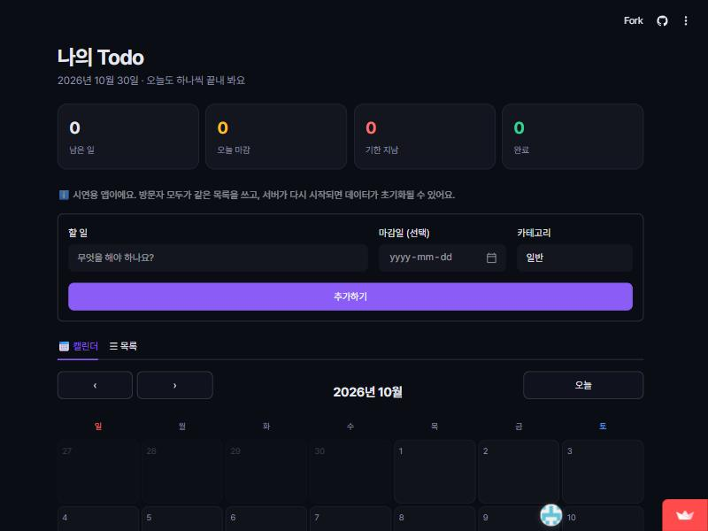
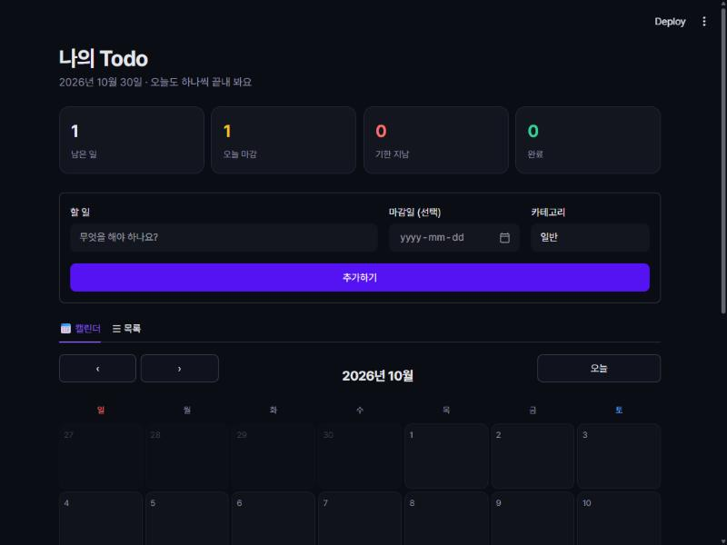
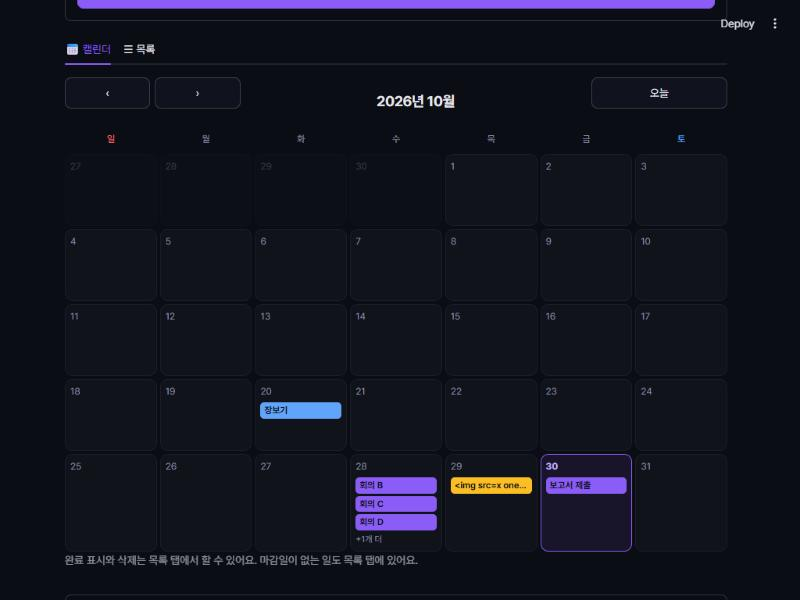
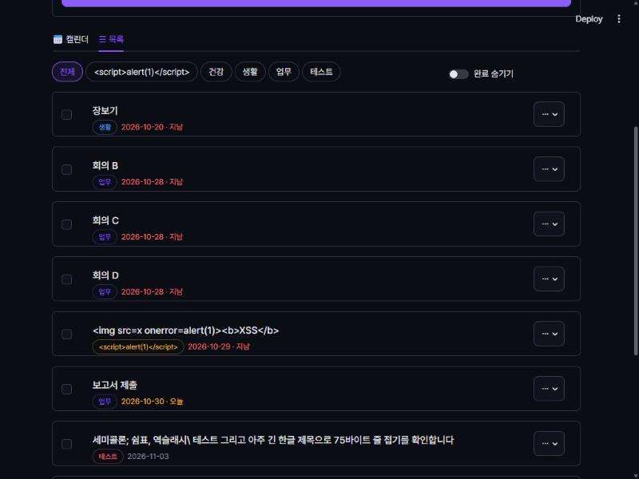
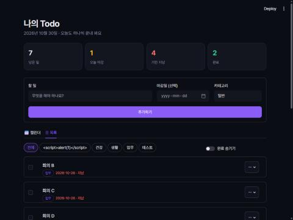
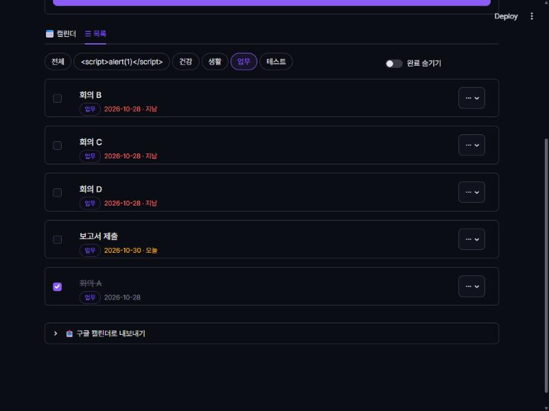
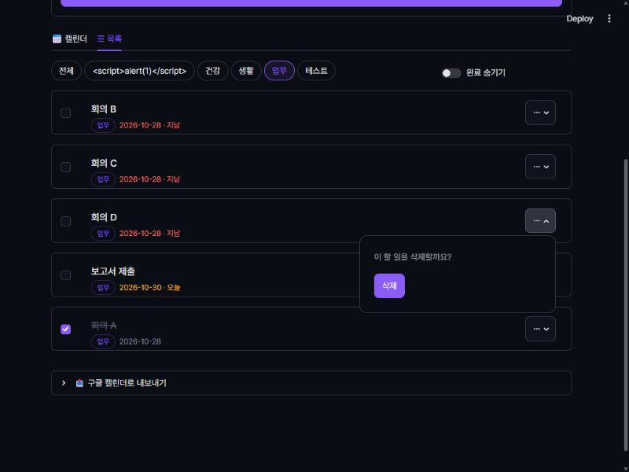
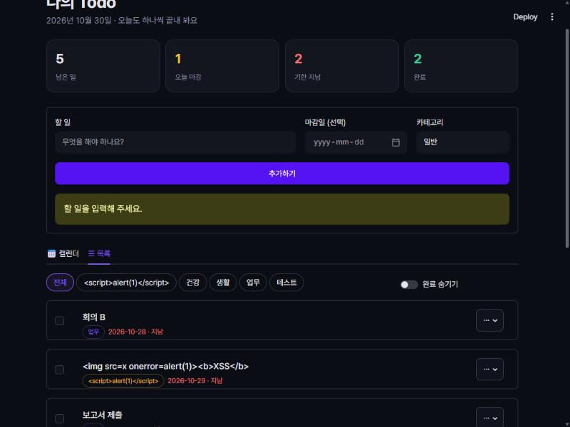
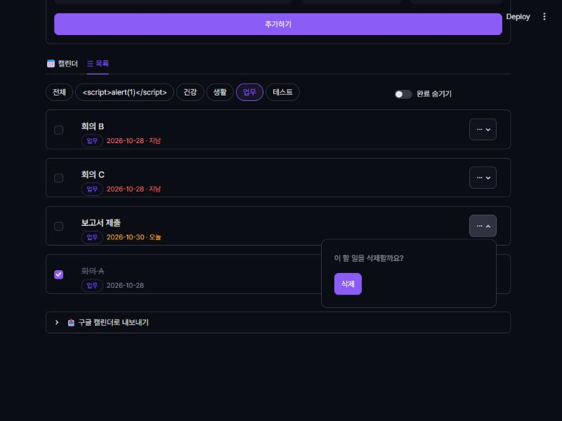
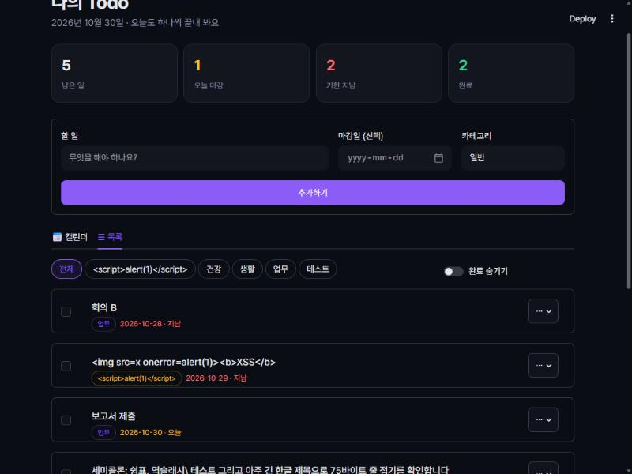

# AIFFEL Campus Agent Code Review Templete
- 개발자 : 김원규
- 리뷰어 : 정채홍
- 대상 저장소: https://github.com/chj-cog/todo-app
- 배포 데모: https://kwkworks-todo.streamlit.app
- 리뷰 일자: 2026-10-30
- 리뷰 환경: Windows 11, Python 3.14.2, `requirements.txt` 그대로 설치한 venv (streamlit 1.66.1, python-dotenv 1.2.4)
- 검증 방법: 로컬에서 `streamlit run app.py`로 실행하고 **임시 DB(`DB_PATH`를 별도 경로로 지정)** 에 테스트 데이터를 넣어 브라우저로 직접 조작. 공개 데모는 첫 화면만 열어 보고 데이터는 건드리지 않았습니다.
- 캡처 이미지: [`review-images/`](review-images/)

---

# ART(Agent Review Template)

## [x] 1. 원하는 기능이 의도한 대로 동작하나요?

PRD(`docs/PRD.md`)의 요구사항을 하나씩 실행해 확인했습니다. **삭제 확인 팝오버에서 버그 1건**을 제외하면 모두 의도대로 동작합니다.

| 요구사항 (PRD) | 결과 | 근거 |
|---|---|---|
| 앱 실행 (명령 두 줄) | ✅ `pip install -r requirements.txt` → `streamlit run app.py`로 바로 실행됨 | 01, 02 |
| 추가: 제목(필수)·마감일(선택)·카테고리 | ✅ 추가 즉시 통계(남은 일 1, 오늘 마감 1)에 반영 | 02 |
| 추가: 빈 제목 거부 | ✅ 공백만 입력하면 "할 일을 입력해 주세요." 경고, 저장 안 됨 | 10 |
| 조회: 미완료 → 완료 순, 마감일 순 | ✅ 마감일 없는 일은 미완료 중 맨 뒤, 완료 항목은 맨 아래 | 04 |
| 완료: 체크박스로 토글 | ✅ 체크 즉시 통계(완료 2, 기한 지남 5→4)와 정렬이 갱신됨 | 05 |
| 삭제: 한 번 더 확인 후 삭제 | ⚠️ 삭제는 되지만 **삭제 직후 확인창이 다음 항목에 붙은 채 열려 있음** (아래 3번 참고) | 07, 08 |
| 마감일 색상: 오늘=노랑, 지남=빨강 (KST 기준) | ✅ 10-30(오늘) 노랑, 10-20·10-28 빨강. 완료된 항목은 색 표시 안 함 | 04 |
| 카테고리 색 + 카테고리별 필터 | ✅ 같은 이름은 같은 색, `업무` 선택 시 업무만 표시 | 06 |
| 캘린더: 월간 표시, 한 칸 3개 + "+N개 더" | ✅ 10/28에 4건 → 3건 + "+1개 더", 오늘 칸 강조, 이전/다음/오늘 이동 | 03 |
| 구글 캘린더 `.ics` 내보내기 | ✅ 마감일 있는 7건만 이벤트로 생성(마감일 없는 1건 제외), 완료 항목은 `✓ ` 접두어 | [샘플 파일](review-images/my-todo-sample.ics) |

### 실행 화면

| | |
|---|---|
| **01 배포 데모 첫 화면** (데이터 0건, 시연용 안내 문구 노출)<br> | **02 할 일 추가 후** (남은 일 1 · 오늘 마감 1)<br> |
| **03 캘린더** (10/28 "+1개 더", 오늘 칸 강조, XSS 문자열은 글자로만 표시)<br> | **04 목록** (정렬, 지남/오늘 색상, `<script>` 카테고리도 글자로 표시)<br> |
| **05 완료 체크 후** (완료 2, 기한 지남 4)<br> | **06 카테고리 필터 `업무`**<br> |
| **07 삭제 확인 팝오버**<br> | **10 빈 제목 입력 시 경고**<br> |

### `.ics` 파일 검사 결과
`app.py`의 `ics_escape` / `ics_fold` / `build_ics` 함수만 떼어 내 테스트 DB로 파일을 만들어 확인했습니다.
- 줄바꿈이 모두 CRLF이고, 가장 긴 줄이 74바이트 → RFC 5545의 "한 줄 75옥텟" 규칙을 지킵니다. 한글(3바이트)이 줄 경계에서 깨지지 않습니다.
- `;` `,` `\` 이스케이프 정상: `SUMMARY:세미콜론\; 쉼표\, 역슬래시\\ ...`
- 날짜만 있는 종일 일정(`DTSTART;VALUE=DATE`, `DTEND`=다음 날)으로 만들어 시간대 문제가 없습니다.

---

## [x] 2. 보안 검토를 수행했나요?

### 민감 정보 하드코딩
- ✅ `app.py`, 설정 파일, **전체 커밋 히스토리**(`git log -p --all`)에서 `api_key / secret / password / token / sk- / ghp_` 패턴을 검색 → 발견되지 않음.
- ✅ 저장소에 올라간 파일은 `.env.example`, `.gitignore`, `.streamlit/config.toml`, `README.md`, `app.py`, `docs/PRD.md`, `requirements.txt` 뿐이고, `.env`와 `*.db`는 `.gitignore`로 제외되어 있음.
- ✅ 설정값(`DB_PATH`)은 `.env`에서 읽고, 없으면 기본값을 쓰도록 되어 있어 비밀값 관리 방식이 적절함.

### 사용자 입력값 검증
| 항목 | 확인 내용 | 결과 |
|---|---|---|
| SQL 인젝션 | 모든 쿼리가 `?` 자리표시자로 값을 전달 (`add_todo`, `set_done`, `delete_todo`). 문자열 이어 붙이기 없음 | ✅ 안전 |
| XSS (HTML 주입) | `unsafe_allow_html=True`를 5곳에서 쓰지만, 사용자 입력(제목·카테고리)은 모두 `html.escape()` 후 출력. 날짜는 `date_input`에서 온 ISO 문자열, 색은 고정 팔레트 값 | ✅ 실제로 제목 ``, 카테고리 `<script>alert(1)</script>`를 넣어도 글자로만 표시됨 (03, 04) |
| 빈 입력 | `title.strip()`이 비어 있으면 저장 안 함, 카테고리가 비면 `일반` | ✅ |
| 길이 제한 | `max_chars=100/20`. Streamlit 소스(`text_widgets.py`의 `TextInputSerde`)를 보면 **서버에서도 `result[:max_chars]`로 잘라 냄** → 클라이언트 우회로도 긴 값 저장 불가 | ✅ |
| `.ics` 주입 | 제목/카테고리의 `\ ; , 줄바꿈`을 이스케이프 → 다른 속성 줄을 끼워 넣을 수 없음 | ✅ |

### 외부 데이터/의존성
- ✅ `pip-audit -r requirements.txt` 결과 **알려진 취약점 없음** (`No known vulnerabilities found`). 버전도 `==`로 고정되어 있음.
- ⚠️ CSS에서 Pretendard 폰트를 `cdn.jsdelivr.net/gh/orioncactus/pretendard@v1.3.9`로 불러옴. 버전이 고정되어 있고 CSS만 받으므로 위험은 낮지만, 외부 CDN이 막히면 기본 글꼴로 바뀌고 방문자 IP가 jsDelivr에 전달됨. (필요하면 폰트 파일을 저장소에 포함하는 방법도 있음)
- ⚠️ **배포 데모는 로그인 없이 DB 하나를 모두가 공유** → 아무나 다른 사람의 할 일을 보고, 완료 처리하고, 삭제할 수 있고, 항목 수 제한이 없어 대량 추가(스팸)도 가능함. PRD 9장 "알려진 한계"와 화면 안내 문구로 이미 고지되어 있어 시연용으로는 허용 범위이나, 개인 정보를 적지 않도록 안내가 더 분명하면 좋겠음 (개선 제안 2 참고).

---

## [x] 3. 에러가 난 부분을 디버깅하여 "문제를 해결한 기록"을 남겼나요?

### 저장소에 남은 기록
- 커밋 메시지로 수정 이력은 일부 확인됨 (예: `95be00d README: localhost 주소를 클릭 링크 대신 안내 문구로 수정`).
- 다만 **에이전트가 만든 코드에서 어떤 오류가 났고 어떻게 고쳤는지에 대한 별도 기록(디버깅 로그, 이슈, 테스트 코드)은 저장소에 없음.** → 개선 제안 4 참고.

### 이번 리뷰에서 발견·해결한 문제

#### 🐞 버그: 삭제 후 확인 팝오버가 다음 항목으로 옮겨 붙음 (오삭제 위험)
1. **발견**: 목록에서 `회의 D`의 `⋯` → `삭제`를 누름. DB에서 `회의 D`(id 7)는 정상 삭제됐지만, 화면이 다시 그려진 뒤에도 **"이 할 일을 삭제할까요? [삭제]" 창이 바로 아래 항목 `보고서 제출`에 붙은 채 열려 있었음.** 여기서 한 번 더 누르면 사용자가 고르지 않은 항목이 지워짐.

   

2. **원인 분석**: `app.py:348`의 `c_del.popover("⋯")`에 `key`가 없음. Streamlit은 key가 없는 위젯을 "라벨 + 화면상 위치"로 구분하기 때문에, 항목이 하나 빠지면 그 자리에 오는 다음 항목의 팝오버를 같은 위젯으로 보고 "열림" 상태를 이어받음. 설치된 1.66.1의 `st.popover` 시그니처에 `key` 인자가 있는 것을 확인함.
3. **수정**: 항목마다 고유 key를 부여.
   ```python
   # app.py:348
   with c_del.popover("⋯", key=f"pop_{t['id']}"):
   ```
4. **검증**: 원본은 그대로 두고 수정본을 임시 폴더에 복사해 8502 포트로 실행, `회의 C`를 삭제 → 삭제 후 팝오버가 닫히고 다른 항목에 옮겨 붙지 않음을 확인.

   

#### 리뷰 과정에서 겪은 문제와 시도
| 문제 | 해결 |
|---|---|
| 외부 저장소 코드를 바로 실행하는 것이 자동 권한 검사에서 차단됨 | 사용자에게 "로컬 실행 / 배포 데모에서 테스트 / 코드 리뷰만" 중 선택을 받아 로컬 실행으로 진행. 공개 데모 데이터는 건드리지 않고, DB도 임시 경로로 분리 |
| 브라우저 자동 입력으로 마감일 칸에 `2026-10-30`을 타이핑하면 값이 들어가지 않음 | Streamlit `date_input`은 연/월/일이 분리된 입력이라 타이핑이 무시됨 → 달력 팝업에서 날짜를 클릭해 입력 (앱 버그 아님) |
| `.ics` 내용을 콘솔에 출력할 때 `UnicodeEncodeError: 'cp949' codec can't encode character '✓'` | Windows 콘솔 인코딩 문제. `py -I -X utf8`로 실행하고 결과를 파일로 저장해 확인 (앱 버그 아님, 앱은 `.encode("utf-8")`로 내려줌) |
| 테스트 데이터 대량 입력 | UI로 1건 추가를 검증한 뒤, 나머지(지난 마감, 마감일 없음, 같은 날 4건, XSS 문자열, 긴 한글 제목)는 `sqlite3`로 임시 DB에 직접 넣어 경계 사례를 한 번에 확인 |

---

# 참고 링크 및 코드 개선

## 1. 리뷰 시 참고한 링크

| 링크 | 설명 |
|---|---|
| [Streamlit `st.popover`](https://docs.streamlit.io/develop/api-reference/layout/st.popover) | 팝오버 `key` 인자 확인 (버그 수정 근거) |
| [Streamlit 위젯 동작 원리 (Widget behavior)](https://docs.streamlit.io/develop/concepts/architecture/widget-behavior) | key가 없을 때 위젯 정체성이 라벨·위치로 정해지는 원리 |
| [Streamlit `st.text_input`](https://docs.streamlit.io/develop/api-reference/widgets/st.text_input) | `max_chars` 동작 확인 |
| [RFC 5545 §3.1 Content Lines](https://datatracker.ietf.org/doc/html/rfc5545#section-3.1) | `.ics` 한 줄 75옥텟 접기 규칙 (`ics_fold` 검증) |
| [RFC 5545 §3.3.11 TEXT](https://datatracker.ietf.org/doc/html/rfc5545#section-3.3.11) | `\ ; ,` 줄바꿈 이스케이프 규칙 (`ics_escape` 검증) |
| [OWASP XSS Prevention Cheat Sheet](https://cheatsheetseries.owasp.org/cheatsheets/Cross_Site_Scripting_Prevention_Cheat_Sheet.html) | HTML 출력 전 이스케이프 원칙 |
| [Python `sqlite3` – placeholders](https://docs.python.org/3/library/sqlite3.html#sqlite3-placeholders) | `?` 자리표시자로 SQL 인젝션 방지 |
| [pip-audit](https://pypi.org/project/pip-audit/) | 의존성 취약점 검사 도구 |
| [Google 캘린더로 일정 가져오기](https://support.google.com/calendar/answer/37118) | `.ics` 가져오기 절차 확인 |

## 2. 개선 제안

1. **[버그·우선] 삭제 팝오버에 key 부여** — `app.py:348`을 `c_del.popover("⋯", key=f"pop_{t['id']}")`로 변경. 위에서 수정·검증 완료. 같은 이유로, 항목별로 반복 생성되는 위젯에는 항상 id 기반 key를 붙이는 것을 규칙으로 두면 좋습니다.
2. **[보안·데모] 공유 DB 노출 줄이기** — 지금은 방문자 누구나 전체 목록을 지우거나 대량으로 추가할 수 있습니다. 시연용이라면 ① 배포 환경에서는 방문자 세션마다 별도 DB(예: `st.session_state`에 메모리 DB)를 쓰거나, ② 전체 항목 수 상한(예: 200개)을 두고, ③ 안내 문구에 "개인 정보는 적지 마세요"를 추가하는 것을 권합니다.
3. **[기능] `.ics` 재가져오기 한계 안내** — 구글 캘린더 가져오기는 같은 `UID`면 내용을 갱신하지만, **앱에서 삭제한 할 일은 캘린더에서 지워지지 않습니다.** README/화면 안내에 이 점을 적어 두면 혼란이 줄어듭니다.
4. **[품질] 자동 테스트와 디버깅 기록 추가** — `ics_escape`, `ics_fold`(한글 경계·75바이트), `build_ics`(마감일 없는 항목 제외), `list_todos` 정렬은 화면 없이 테스트할 수 있는 순수 함수입니다. `pytest` 몇 개와 Streamlit의 [`AppTest`](https://docs.streamlit.io/develop/api-reference/app-testing)로 "추가 → 완료 → 삭제" 흐름을 고정해 두면, 이번 팝오버 같은 회귀를 막을 수 있습니다. 함께 `docs/DEBUG_LOG.md` 같은 문서에 에이전트 코드에서 발견한 오류와 수정 과정을 남기는 것을 권합니다.
5. **[UX] 카테고리 이름 정규화** — `업무`와 `업무 `(공백)은 `strip()`으로 처리되지만, `Work`/`work`처럼 대소문자만 다른 이름은 다른 카테고리가 됩니다. 필요하면 소문자 비교나 기존 카테고리 선택 UI(`st.selectbox` + 새로 입력)를 고려해 볼 만합니다.
6. **[선택] 외부 폰트 의존 제거** — Pretendard를 CDN `@import` 대신 저장소에 포함하면 오프라인/사내망에서도 동일하게 보이고 외부 요청이 사라집니다.

---

# 총평

PRD에 적힌 필수 기능(CRUD)과 추가 기능(마감일 색상, 카테고리, 월간 캘린더, `.ics` 내보내기)이 **모두 실제로 동작**하며, 코드가 370줄 남짓한 한 파일 안에서 DB / `.ics` / 디자인 / 화면 영역으로 잘 나뉘어 있고 주석도 친절해 읽기 쉽습니다.

보안 기본기도 좋습니다. SQL은 전부 자리표시자를 쓰고, `unsafe_allow_html`을 쓰는 모든 곳에서 사용자 입력을 `html.escape()` 처리해 실제 XSS 문자열을 넣어도 안전하게 표시되었습니다. 비밀값 하드코딩이 없고 `.env`·DB 파일이 커밋되지 않으며, 의존성 버전 고정 + 알려진 취약점 0건입니다. `.ics` 생성도 RFC 5545의 이스케이프와 75바이트 줄 접기를 한글까지 고려해 정확히 구현했습니다.

가장 중요한 지적은 **삭제 확인 팝오버가 다음 항목으로 넘어가는 버그**로, 사용자가 의도하지 않은 항목을 지울 수 있어 우선 수정을 권합니다(한 줄 수정, 검증 완료). 그 밖에는 공개 데모의 공유 DB 노출, 자동 테스트·디버깅 기록 부재가 아쉬운 점입니다.

**결론: 버그 1건 수정 후 승인 권장 (Approve with minor changes).**
